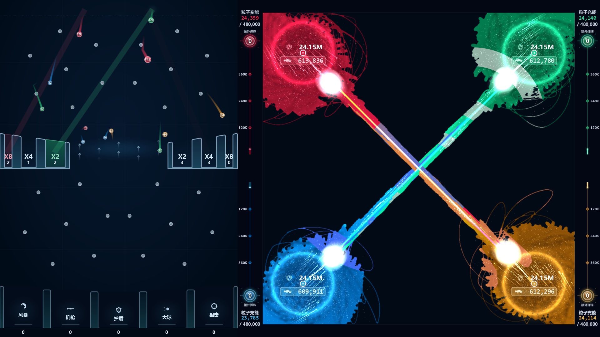

# War4Balls · 球球领土战争

使用 **Godot 4.6.2 .NET + C#** 开发的四阵营弹珠与领土战争游戏。左侧弹珠台积累数值并触发技能，右侧红、绿、蓝、黄四个阵营在 **1000 × 1000** 像素战场上争夺领土。



## 游戏内容

- **弹珠台**：上升气流、旋转障碍、翻倍槽，以及机枪、护盾、狙击、风暴、大球五种技能槽。
- **领土战争**：自动旋转机枪、粒子吸收与充能、护盾、大球碰撞、阵营淘汰和胜负判定。
- **资金模式**：根据阵营实时胜率进行游戏内的模拟做多、做空与杠杆交易。
- **答题补充资金**：内置选择题题库，每答对 5 题获得 $10 游戏内资金。
- **游戏设置**：调整初始数值、落槽概率、交易选项，并切换中英文界面。

## 环境要求

- **Godot 4.6.2 .NET 版**，标准版不支持此项目的 C# 脚本。
- **.NET 10 SDK**：项目使用 C# 14，并以 `net9.0` 为目标框架；运行时还需要 **.NET 9 Runtime**。
- 当前渲染配置为 **Forward Plus**，需要支持该渲染器的显卡及驱动。
- 中文界面使用系统字体；Windows 默认可用微软雅黑，其他系统可安装 Noto Sans CJK SC 或思源黑体。

## 启动

```sh
git clone https://github.com/1bytes-sb/War4Balls-BallTerritoryWar.git
cd War4Balls-BallTerritoryWar
dotnet build BallTerritoryWar.csproj
```

使用 Godot .NET 编辑器导入根目录的 `project.godot`，等待资源导入完成后按 **F6/F5** 运行场景或项目；也可以在构建后从命令行启动：

```sh
godot --path .
```

这里的 `godot` 指 Godot .NET 可执行程序；可替换为实际路径。第一次启动会进入主菜单。

Windows 可以双击 `run_game.bat`。脚本会先构建 C#，再启动游戏，优先使用 `GODOT` 环境变量指定的可执行文件，否则搜索 `PATH`，也兼容项目旁原有的 `../tools/godot462mono/` 目录。例如在 PowerShell 中：

```powershell
$env:GODOT = 'C:\Tools\Godot\Godot_v4.6.2-stable_mono_win64.exe'
.\run_game.bat
```

## 操作

| 按键 | 功能 |
| --- | --- |
| `F2` | 对局中返回主菜单，资金模式会结算退出 |
| `R` | 重新开始对局 |
| `F11` / `Alt + Enter` | 切换全屏 |
| `Esc` | 全屏时退出全屏；菜单中返回上一层 |
| `1`～`4` / `A`～`D` | 答题界面选择选项 |
| `Enter` | 答题后继续 |

设置和游戏内资金分别保存在 Godot 用户目录的 `settings.cfg` 与 `wallet.cfg`，不会写入源码目录。

## 项目结构

```text
scenes/                    主场景 Main.tscn
scripts/
  core/                    游戏入口、全局参数、语言切换
  gameplay/                弹珠、战场、阵营、领土与碰撞逻辑
  rendering/               球体绘制、图标、字体
  trading/                 模拟交易、钱包、胜率模型
  ui/                      主菜单、设置、交易面板、胜率图表
  quiz/                    题库读取和答题界面
shaders/                   领土合成着色器
data/                      题库及格式说明
docs/
  images/                  实际运行截图
  reference/               原始视觉参考图
  original-brief.txt        原始需求记录，当前实现已有后续调整
project.godot              Godot 项目配置
BallTerritoryWar.csproj     C# 项目与 Godot SDK 版本
export_presets.cfg         Windows 导出预设
run_game.bat               Windows 构建与启动脚本
```

Godot 缓存、编译产物、导出文件和本机配置由 `.gitignore` 排除。原有旧项目文件、手工复制的 GodotSharp.dll、辅助脚本与大型参考视频保留在本机 `.local/` 下。

## 调试与导出

游戏已有调试参数。Godot 自身参数放在 `--` 之前，游戏参数放在之后：

```sh
# 直接进入普通对局，运行 10 秒后退出并输出统计
godot --path . -- --quit=10 --stats=5

# 打开主菜单，切换英文界面
godot --path . -- --menu --lang=en

# 使用调试余额进入资金模式
godot --path . -- --wallet=100 --funds=50 --quit=10

# 进入答题界面
godot --path . -- --quiz --quit=5

# 在模拟时间第 8 秒保存截图（目标目录需已存在）
godot --path . -- --shot=8:docs/images/gameplay.png --quit=9
```

带游戏调试参数运行时使用临时钱包，避免覆盖正常游戏余额（仅传 `--fullscreen` 除外）。还可使用 `--timescale=2` 加速，或用 `--set=字段名=数值` 临时覆盖 `scripts/core/GameSettings.cs` 中的参数；完整参数处理见 `scripts/core/Main.cs`。

导出 Windows 版本前，在 Godot 中安装 **4.6.2 对应的 .NET 导出模板**，然后在编辑器中使用 `Windows Desktop` 预设。命令行方式如下（`mkdir -p` 适用于 Bash，PowerShell 可用 `New-Item -ItemType Directory -Force build/windows`）：

```sh
mkdir -p build/windows
godot --headless --path . --export-release "Windows Desktop" build/windows/BallTerritoryWar.exe
```

题库已通过 `include_filter="data/*.txt"` 配置随导出打包；文档与本机辅助文件不会进入游戏包。

## 题库来源

题库文件的格式和现有来源记录见 [data/README.md](data/README.md)。代码保留原有题库署名；仓库未额外指定统一开源许可证。
